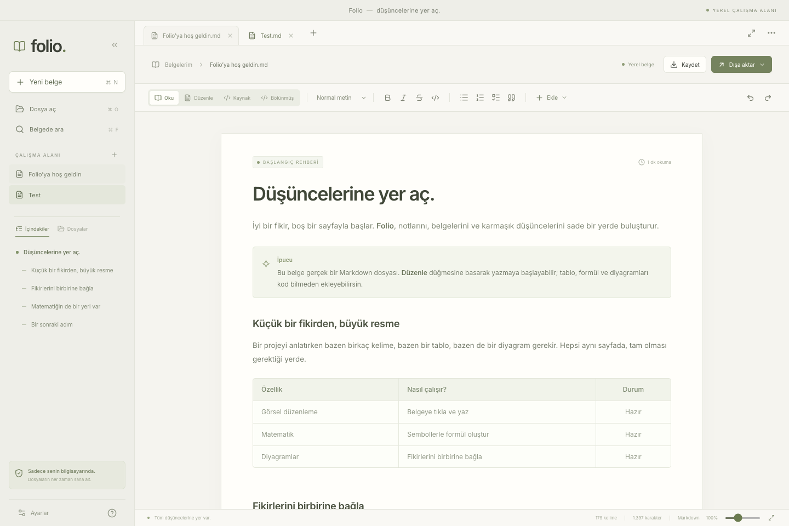

# Folio

**Markdown belgelerini kod bilmeden oku, düzenle ve yanında taşı.**

[Özellikler](#çalışan-özellikler) · [Geliştirme](#geliştirme) · [Teknik isterler](PROJE_TEKNIK_ISTER_DOKUMANI.md) · [Test raporu](docs/TEST_RAPORU.md) · [Katkı rehberi](CONTRIBUTING.md)



Yerel dosyalarla çalışan masaüstü Markdown okuyucu ve görsel düzenleyici. Electron, React ve TypeScript ile geliştirildi. Bir hesap veya uygulama sunucusu gerektirmez.

**Proje durumu:** Çalışan masaüstü uygulaması ve üç platform için yerel paketler mevcuttur. Teknik isterlerin tam üretim kabulü henüz tamamlanmamıştır. Doğrulanan işlevler ve açık maddeler [teslimat kontrolünde](docs/TESLIMAT_KONTROLU.md) izlenir.

## Uygulamayı açma

Aşağıdaki paketler yerel çalışma alanında üretilmiştir; büyük kurulum dosyaları Git geçmişine eklenmez. GitHub Actions çalışmaları başarılı olduğunda platform paketleri ilgili çalışmanın **Artifacts** bölümünden alınabilir. İmzalı bir genel yayın henüz yoktur.

Apple Silicon Mac üzerinde `release/mac-arm64/Folio.app` doğrudan çalıştırılabilir. `release/Folio-1.0.0-mac-arm64.dmg` kurulum için, aynı adlı ZIP ise uygulama paketini taşımak için üretilir.

Yerel paket yayıncı sertifikasıyla imzalanmamıştır ve Apple noter onayı yoktur. İmzalı genel dağıtım için yayıncıya ait sertifikalar gerekir. Sistem güvenlik ayarlarını küresel olarak kapatmayın.

Windows x64 için Setup/Portable `.exe`, Linux x64 için AppImage/DEB dosyaları `release/` içinde üretildi. Windows ve Linux paketleri ilgili işletim sistemlerinde henüz çalıştırılmadı. macOS ARM64 uygulama paketi bu bilgisayarda çalıştırılarak doğrulandı.

## Geliştirme

Node.js 24 veya üzeri ve npm gerekir. Depoyu klonlayıp kilit dosyasındaki sürümlerle kurun:

```bash
git clone https://github.com/onurcankaraman/folio-markdown.git
cd folio-markdown
npm ci
npm run desktop
```

Yalnız arayüz önizlemesi:

```bash
npm run dev
```

Tarayıcı önizlemesi bir masaüstü uygulamasının dosya yetkilerine sahip değildir. Kaydetme dosya indirme olarak çalışır; yerel klasör, sürüm geçmişi ve dosya izleme için Electron uygulaması kullanılmalıdır. Önizlemede bu fark durum çubuğunda gösterilir.

Üretim derlemesini yerel olarak çalıştırma:

```bash
npm run build
npm start
```

## Çalışan özellikler

- Okuma, doğrudan görsel düzenleme, gerçek Markdown kaynağı ve bölünmüş görünüm.
- Başlıklar, kalın/italik/üstü çizili, listeler, görev kutuları, alıntılar ve kod blokları.
- Tablo ekleme; satır/sütun ekleme, silme, taşıma ve hizalama; TSV yapıştırma; CSV/TSV önizlemeli içe ve dışa aktarma.
- Dosyadan veya panodan görsel, göreli varlık klasörü ve yerel bağlantılar.
- MathLive ile görsel matematik girişi, boyut seçmeli matris/determinant, sembol/şablon paleti ve KaTeX ile çizim; LaTeX/MathML kopyalama, çevrimdışı SVG/PNG çıktısı, PNG ölçek ve saydamlık seçenekleri.
- 16 Mermaid türü için tuval veya form/veri tabanlı düzenleme; canlı önizleme, kaynak ve SVG çıktısı.
- Dipnotlar, bilgi kutuları, görsel gövde düzenlemeli açılır bölümler ve YAML özellik paneli.
- Sekmeler, sabitleme, sıralama, kapatılan sekmeyi açma ve kaydedilmiş oturumu geri yükleme.
- Klasör ağacı, yeni dosya/klasör, yeniden adlandırma, çöp kutusu ve klasörde toplu arama/değiştirme.
- Gerçek dosyada çakışma denetimi, atomik kaydetme, üç yönlü birleştirme, kurtarma taslakları ve kayıt geçmişi.
- UTF-8/BOM ve UTF-16; geçersiz UTF-8 için kodlama seçimi; mevcut satır sonlarını koruma.
- PDF, fontları gömülü bağımsız HTML ve görselleri içeren ZIP. ZIP içe aktarmada yol, boyut, çakışma ve CRC kontrolleri.
- Türkçe/İngilizce ana arayüz, açık/koyu/sistem teması, yakınlaştırma ve odak modu; doğrulama ve uygulama önizlemeli ayar dosyası içe aktarma.

Bu liste temel işlevleri anlatır; her özelliğin teknik isterdeki bütün gelişmiş seçeneklerini kapsadığı iddiası değildir. Özellikle diyagramların ileri seçenekleri için teslimat kontrolünü okuyun.

## Veri güvenliği ve gizlilik

Dosyanın özgün kaynağı saklanır. Değişmeyen üst düzey bloklar yeniden yazılmaz; değişen bloklar kontrollü olarak üretilir. Markdown → HTML → Markdown dönüşümüyle bütün belgeyi yeniden kaydetme yapılmaz. Tanınmayan içerikler kaynakları korunarak açılır.

Kayıt, aynı dizindeki geçici dosyaya yazma, dayanıklı aktarım, son disk özeti denetimi ve atomik değiştirme kullanır. Kaydetme başarısız olduğunda belge açık kalır. İşletim sistemi düzeyinde koşullu değiştirme desteği olmayan dosya sistemlerinde son kontrol ile yeniden adlandırma arasında çok dar bir yarış aralığı kalabilir; ağ dosya sistemleri için yerel disk düzeyinde garanti verilmez.

Otomatik kurtarma taslağı ile gerçek dosyaya otomatik kaydetme ayrı işlemlerdir. Gerçek otomatik kaydet varsayılan kapalıdır. Taslaklar 2 saniyelik boşta kalma süresinden sonra, sürekli yazımda 10 saniyede bir korunur. Taslaklar açık metindir; uygulama düzeyinde şifreleme iddia edilmez.

Renderer'da Node erişimi kapalıdır; sandbox ve context isolation açıktır. Diyagramlar masaüstünde ayrı, ayrıcalıksız bir pencerede çizilir; süre aşımında bu pencere kapatılır. Belge içinden kod çalıştırılmaz. Uzak görseller varsayılan yüklenmez. Güncelleme kontrolü kullanıcı eylemi olmadan ağ isteği başlatmaz.

## Taşınabilir veri klasörü

- Windows portable paketi, kendi bulunduğu klasörün altındaki `data/` klasörünü kullanır.
- macOS'ta `.app` dosyasının yanına, Linux'ta çalıştırılabilir dosyanın yanına `portable.json` eklemek taşınabilir veri modunu etkinleştirir. Dosyanın içeriği `{}` olabilir.
- ZIP'ten çıkarılmış `.app` kendi başına ayarların da taşınabilir olduğu anlamına gelmez; işaretçi gerekir.
- `FOLIO_DATA_DIR` ortam değişkeni, portable işaretçisi yokken özel bir veri klasörü seçmeye yarar. Paket testleri bu şekilde kullanıcı profilinden ayrılır.
- Yazılamayan veri konumunda klasör seçme veya geçici oturum seçenekleri gösterilir; sessizce başka bir profile geçilmez.

İşletim sisteminin geçici dosyaları ve kayıtları nedeniyle “hiç iz bırakmaz” iddiası yoktur.

## Testler

```bash
npm test
npx playwright install chromium
npm run test:e2e
```

Uçtan uca test komutu önce üretim derlemesini oluşturur. Testler geçici dosyalar ve ayrılmış bir Electron profili kullanır. macOS üzerinde oluşturulan gerçek uygulama paketi ayrıca kontrol edilebilir:

```bash
node scripts/smoke-packaged.mjs
```

Son doğrulamada 55 çekirdek/dosya testi ve 17 uçtan uca senaryo geçti. Ayrıntılar [test raporunda](docs/TEST_RAPORU.md), formül kapsamı [matematik envanterinde](docs/MATEMATIK_DESTEGI.md) bulunur.

Test sayısı, teknik isterdeki kabul kriteri sayısıyla aynı şey değildir. Test kapsamının sınırları teslimat kontrolünde belirtilir.

## Paketleme

```bash
node scripts/icons.mjs
npm run package:mac
npm run package:win
npm run package:linux
node scripts/release-metadata.mjs
```

Diğer mimari için doğrudan `npx electron-builder --mac --x64 --publish never` gibi bir hedef kullanılır. Platform paketleri esas olarak kendi işletim sistemlerinde oluşturulmalıdır. GitHub Actions dosyası platform/mimari işleri içerir. `main` güncellemeleri, sürüm etiketleri ve elle başlatılan çalışmalar doğrulama ve paketleme akışını tetikler.

İmzalama, noter onayı ve yayın adresi yönetimi için [yayınlama rehberini](docs/YAYINLAMA.md) okuyun.

## Kaynak düzeni

```text
electron/                 Dosya, kayıt, güvenlik, paket, güncelleme ve platform köprüsü
src/core/                 Markdown kaynak koruma, diyagram modelleri, arama ve geçmiş
src/components/           Görsel editörler ve belge araçları
src/App.tsx               Uygulama yerleşimi ve belge oturumlarının koordinasyonu
tests/                    Çekirdek, dosya, paket ve gerçek kullanıcı akışları
build/                    Uygulama simgesi ve platform simgeleri
scripts/                  Simge, paket kontrolü ve yayın meta verisi üretimi
docs/                     Teslimat durumu, yayın rehberi ve ekran görüntüleri
```

## Bilinen kullanım sınırları

- Yerel Markdown dosyası: 60 MiB açılış sınırı; büyük belgeler için tüm performans hedefleri henüz doğrulanmadı.
- Görsel: dosya başına 25 MiB.
- Görsel diyagram modeli: 500 düğüm, 1.000 bağlantı veya 2.000 veri satırı; 256 KiB kaynak.
- Formül: 32 KiB; güvenilmeyen HTML/bağlantı komutları kapalı.
- ZIP içe aktarma: 100 MiB sıkıştırılmış, 500 MiB açılmış içerik, 10.000 dosya. Çok parçalı/ZIP64 ve şifreli arşivler reddedilir.
- ZIP çıktı: 40 MiB toplam kaynak/varlık sınırı. Aşımda sessizce eksik paket üretilmez.
- Klasör araması: 2.000 dosya ve 50 MiB toplam tarama; dosya başına 5 MiB.


## Bağımlılıklar ve lisanslar

Üçüncü taraf bileşen bildirimleri `node scripts/release-metadata.mjs` ile üretilir; lisans metinleri uygulama paketlerine eklenir. Üretilen dosyalar Git geçmişine alınmaz. Projenin kendi kaynak kodu için henüz bir açık kaynak lisansı seçilmemiştir.
